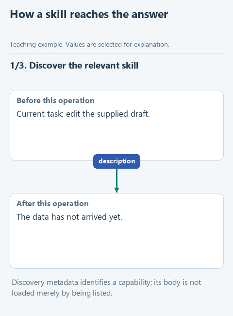

# From editorial corrections to a reusable skill

You ask a model for a clear lesson. It brings back a neat text split into sections: the spelling is fine, the sentences are short, the code looks convincing. A few lines in, a question appears: what did I just open, where did this data come from, and why should I know which function to call?

That kept happening while we prepared a course about AI agents. Context had to be put back again and again: show the actual lines of the notes, explain why the query changed, point to the exact download button. Sometimes the fix overshot the other way, and a single needed explanation turned into a long reference section that buried the task.

Taken one by one, these are editorial fixes. Taken together, they show a way of working: first understand where the reader gets stuck, then build the explanation, check the transitions, and only then polish the sentences. That is what we wanted to keep for the next piece of writing, so we packed it into a skill, `write-clear-english`.

## Keep the reason for a correction, not its words

"The search results remained in Python" sounds like it names a place, but what is missing is an operation: the program returned a list and has not put it into a request to the model yet. The useful rule is to name the actual actor, the transfer and the result. Banning the word "inside" would not solve that wider problem.

Likewise, a threshold changing from two days to five is not a bad example in itself. The reader needs a transition explaining the new experiment and its purpose. A rule demanding one fixed threshold everywhere would block useful comparisons instead of making them clearer.

So the skill works on reasoning and continuity rather than a list of forbidden phrases. It separates facts from interpretations, checks whether a conclusion follows and asks whether a shortened sentence has lost an important condition.

## Motivation and a human voice

A later round of corrections was about motivation. One draft argued that requirements a developer understands can be verified, and so agreed with the client. True, but no analyst learns a new tool for that. What persuades is what matters to a person in their role: for an analyst, understanding LLM integrations sets them apart from peers; for a manager, it is control, because trusting a black box means giving up control over work you are still accountable for. The skill now has a reference, `motivation.md`, with this way of reasoning.

The most visible correction was that the text must not read as machine-written. "The file looks the way documents edited by humans usually look" is grammatical, but it is written by an observer who is not one of those humans. Nearby were other patterns: a disclaimer closing every paragraph, "not X, but Y" in a row, triplets, slogan conclusions, rhetorical questions answered at once. Each appears in human writing too; together they make the machine tone readers recognize. The reference `natural-voice.md` collects them with fixes, and the script `check_style.js` marks common stock phrases for the editor to reread.

## What a skill changes

A request such as "Edit this explanation for an analyst seeing the table for the first time" describes the current job. The skill supplies the recurring editorial method: establish the task, show actual field values, keep the selection conditions and introduce a changed threshold before using it.

In [OpenCode's skill mechanism](https://opencode.ai/docs/skills/), the application discovers a skill folder's name and description, and the native skill tool loads its instruction body when the skill is chosen. The model can then read a reference or use a provided script when the task calls for it. These are separate events; saving a Markdown file does not make any of them happen.



[Static version](../assets/skill-workflow.png).

An `AGENTS.md` file plays a related but different role: an application can read it as project guidance. Neither that file nor `SKILL.md` becomes a system instruction because of its name; the surrounding application decides what is read, how it is included and which tools can run.

## What is in the package

```text
write-clear-english/
|-- SKILL.md
|-- references/
|   |-- reader-first.md
|   |-- hands-on-lessons.md
|   |-- examples.md
|   |-- motivation.md
|   `-- natural-voice.md
|-- scripts/check_text.js
|-- scripts/check_style.js
|-- assets/check-text.html
`-- agents/openai.yaml
```

`SKILL.md` holds the core workflow and points to the detail. The references explain the reasoning and show revisions. `check_text.js` checks for ordinary keyboard punctuation, and the browser page runs the same check without Node.js. `check_style.js` gives hints about machine-sounding phrases. `agents/openai.yaml` describes the package to applications that use it; you do not paste it into requests.

A script belongs in a skill when it does a concrete, repeated operation. The punctuation script finds characters and their positions. Whether the argument holds, an example is true or a paragraph reads naturally is still for the editor, which is why the skill tells them to compare the text with its facts after any mechanical check.

## Check loading separately from quality

Three observations are worth keeping apart: the application discovered the skill, its body or a reference reached the model, and the resulting text met a criterion you set. "I used the skill" from the agent establishes none of them on its own.

Look at the activity trace and save the actual output. When testing a new rule, keep the model and input fixed and use a fresh session so earlier instructions do not carry over. The wording still will not repeat word for word; what we control is the inputs and the comparison.

One successful example is also too narrow. The final exercise moves from request filtering to an answer based on a policy fragment. If the skill drags A-17 into that new setting, it has kept the example instead of the principle.

## Use the ready package or build your own

To try the ready version, download [write-clear-english.zip](../downloads/write-clear-english.zip), extract the folder and copy it into your project's `.opencode/skills` folder. Open that project, start a fresh session and ask for the skill explicitly. This installs it for that project only; nothing in the course installs it globally.

To build your own, follow the [seven-step workbook](workbook.md). Its starters contain different stages on purpose; replacing them all with the final package would hide the changes the lessons are meant to show.
