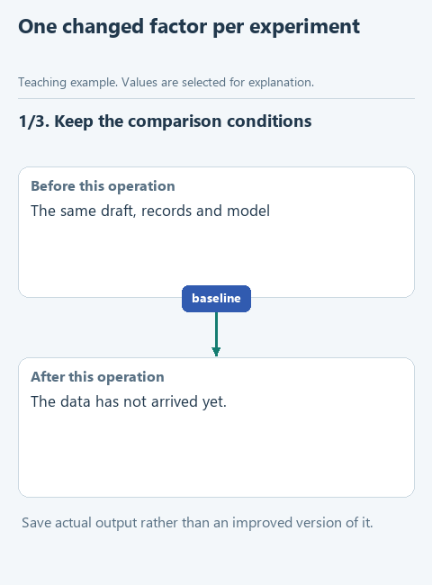

# Build a writing skill one change at a time

We start with an ordinary request to edit a text, then add rules to `SKILL.md` one at a time and check the result after each. At every step we look at which instruction the agent received and what changed in the explanation. This is a way to understand how a skill works before moving a ready package into another project.

The task stays the same throughout: turn a short, dry text into a clear explanation for an analyst. The facts are small enough to check directly. A-17 is new and three days old; A-18 is approved and one day old. The original rule selects requests that are not approved and are older than two days. A second experiment raises the threshold to five days, and then neither record qualifies. The draft names fields abruptly, changes the threshold without warning and claims an efficiency gain nobody measured.

If an answer is already good without a new rule, we write that down. A failure is informative too: it helps tell a skill that did not load from an instruction that is badly worded.

## The steps

| Step | What changes | What stays fixed |
|---|---|---|
| [0. Workspace](../lessons/00-setup.md) | Install the application, choose a model | No skill yet |
| [1. Baseline](../lessons/01-baseline.md) | Save an ordinary edit | Draft, facts and model |
| [2. First skill](../lessons/02-first-skill.md) | Add a name, a description and one rule | The same editing request |
| [3. Reader context](../lessons/03-reader-context.md) | Spell out what to explain about the data | The same records and thresholds |
| [4. Reference](../lessons/04-references.md) | Move an example into a file and point to it | The same criteria |
| [5. Checker](../lessons/05-checks.md) | Add a punctuation check | A separate review of the facts |
| [6. Transfer](../lessons/06-transfer.md) | Try another text and a new project folder | Loading and output are recorded |

Each step has its own archive and a visible folder under [exercises](../exercises/README.md). In each archive the earlier steps are done in my version; your own wording stays in the previous folder. The animations in the lessons show the order of steps; the real model output is what you get in your own runs.

[Static version](../assets/experiment-cycle.png).

## Comparing exactly one change

The ready starters make it easy to follow the structure, but their earlier rules may differ from the ones you wrote. Comparing two archives therefore does not isolate the effect of your own sentence. For that, stay in one folder: get an answer with the working skill and save a copy of it, change one rule, start a new session and repeat the same request. Keep the other inputs, the model and the references as they were.

A single good answer is an observation. To be sure a change helps consistently, repeat both versions a few times in new sessions and check the same signs, without picking only the best answer.

## What to save

Record the model, the application version, the date, the changed instruction, the evidence of loading, the actual output and open questions. Save each answer separately, and do not tidy an old answer before comparing it with a new one.

Judge the explanation against the facts. Can a reader tell what `status` and `elapsed_days` mean, reconstruct both conditions and explain the second threshold? Did the answer invent a button, a service or a measured benefit? These checks tell you more than a general sense that the prose sounds better.

If a reference was read but the answer did not change, record both facts. If the model already produces a good baseline, no visible change is still a valid result. If the new task in step 6 shows a rule tied to the old row ID, narrow the instruction instead of hiding the result.

Start with [setting up the workspace](../lessons/00-setup.md), or look at the [ready skill](../skill/write-clear-english/SKILL.md) when you want to see the final organization.
