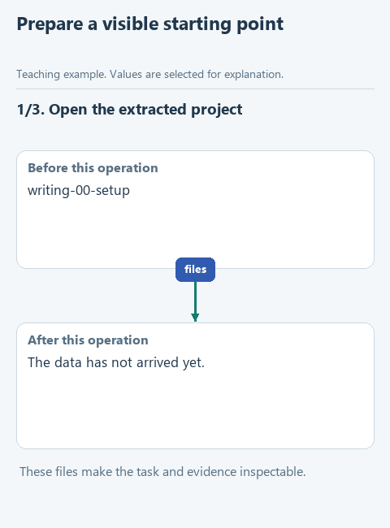

# Prepare the workspace

> **Where we are.** The start of the workbook. We set up the application and model on which every later change to the skill will be tested.

We will take a short, awkward explanation of a work task and improve it with an agent. Then we will change the editing instructions step by step and watch how each change affects the result. For that we need OpenCode, a working model and a folder with the training texts. Getting this right first means a later problem with loading the skill will not be confused with a missing model connection.

## Open this step

Download [writing-00-setup](../downloads/writing-00-setup.zip) and extract it into its own folder. Inside are `TASK.md` with the task, `facts.md` with the facts the text must respect, `source.md`, `requests.csv` and a `results` folder for your answers and notes.

## Do the experiment

Open the [OpenCode download page](https://opencode.ai/download). Under **OpenCode Desktop**, choose **Windows (x64)** if that matches your computer, or the download for your platform. Run the installer and start OpenCode Desktop. The terminal install commands elsewhere on that page are a different route; we use the desktop application.

In OpenCode, open the extracted `writing-00-setup` folder as the project. Edit lesson files in any plain text editor. On Windows, turn on **View -> Show -> File name extensions** in File Explorer, so a file called `SKILL.md.txt` is not mistaken for Markdown later.

In the model selector, choose an available model. The [official model catalog](https://opencode.ai/v2/docs/console/models/) lists temporary free models; on 2026-10-22 it included Big Pickle. Pick an option marked free for your account and write down its exact name: later comparisons only make sense with the same model. A model connection you already have works too. There is no need to buy a subscription for this small experiment.

Create a new session and send the contents of `PROMPT.md`. A short reply means requests reach the model. In `results/observations.md`, write down the date, the application version, the model and the reply. There is no skill in this step yet.

[Static version](../assets/step-00.png).

## Before the next step

OpenCode has the right folder open, the model replies, and you know where the input files are. If the model is unavailable, sort that out before editing any skill files.

Next: [record a baseline edit](01-baseline.md). [All lessons](../README.md#lessons).
