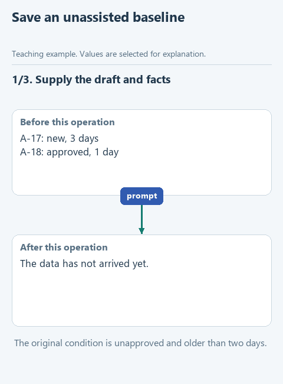

# Record a baseline edit

> **Where we are.** The application and model work. Now we get an edit without any skill: every later step is compared with it.

Before adding rules, we need something to compare against. The training draft is a short paragraph about selecting approval requests. It names table fields without explaining them, changes an age threshold without a word of transition and promises an efficiency gain nobody measured. We ask a model to edit it and see what it fixes on its own and what stays unclear.

## Open this step

Download [writing-01-baseline](../downloads/writing-01-baseline.zip), extract it into its own folder and open that folder in OpenCode with the same model as before. Your answers from the previous step stay in their own folder.

## Do the experiment

Open `source.md`, then check it against `facts.md` and the table `requests.csv`. In the table, `status` is the state of a request and `elapsed_days` the number of days since it was submitted. We select requests that are not approved and are older than two days. A-17 is `new` and three days old, so it qualifies. A-18 is `approved` and one day old, so it fails both conditions. A second experiment raises the threshold to five days, and then neither row qualifies.

Create a new session. Open `PROMPT.md`, copy all of it and send it in the chat; it already contains the source and the facts. No skill is used here. If you have a writing skill installed globally, ask the agent not to load it and check the activity trace to confirm; the application's own standing rules still apply.

Save the answer as `results/baseline.md`, exactly as the model wrote it. In `results/observations.md`, note two concrete observations: can a reader tell from the edit why A-17 is selected? Is the five-day threshold introduced, or does it appear out of nowhere? Did the text invent a button, a program or a measured benefit?

If the baseline is already good, write that down too: we need a reference point, not a bad starting text.

[Static version](../assets/step-01.png).

## Before the next step

`results/baseline.md` holds the real edit and `results/observations.md` says which conditions it explains and where questions remain. There is no single correct text here; what matters is that the facts survive and you know what to improve.

Next: [create the first SKILL.md](02-first-skill.md). [All lessons](../README.md#lessons).
