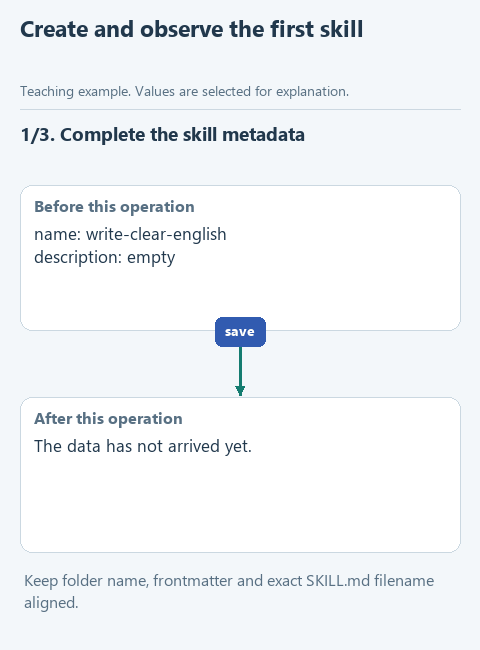

# Create the first SKILL.md

> **Where we are.** We have a baseline edit without a skill. Now one editorial rule moves from the request into a SKILL.md file, and we check that the agent actually loads it.

Repeating the same preference in every request gets tiresome. A skill gives the application a named place for reusable guidance. We start small: one rule in `SKILL.md`, and a careful look at how the agent finds and loads it. The full ready-made skill can wait; first we follow a single instruction on its way to the model.

## Open this step

Download [writing-02-first-skill](../downloads/writing-02-first-skill.zip), extract it into its own folder and open that folder in OpenCode with the same model.

## Do the experiment

In File Explorer, open **.opencode -> skills -> write-clear-english -> SKILL.md** in a plain text editor. The file already has the right name and extension.

Between the `---` lines at the top is the YAML header: `name` is the skill's name and `description` says what tasks it is for. The folder name and `name` already match, as [OpenCode's skill documentation](https://opencode.ai/docs/skills/) requires. Fill the empty `description` with a concrete use, for example editing an explanation of a work task for an analyst from supplied facts. Then replace the marked placeholder below the header with one rule in your own words: keep the supplied facts and do not claim a measured improvement when no measurement was supplied. The point is to keep a way of editing, not one lucky answer.

Save the file. Create a new session with the same model and send all of `PROMPT.md`. The only new thing in it is the request to load `write-clear-english`; the source and facts are unchanged.

In the activity trace, expand the `skill` action and check that the agent loaded `write-clear-english` with your new text. If it only says "I used the skill", loading is not confirmed. If you see an ordinary file read instead of the `skill` action, write that down: the text may have reached the model, but skill discovery itself has not been shown.

If the skill is not found, compare the path, the file name, the header and the folder opened as the project, then start a fresh session after saving. Adding more rules will not fix a discovery problem.

Save the new answer separately and compare it with the baseline.

[Static version](../assets/step-02.png).

## Before the next step

The trace shows what was loaded and how, and the edit keeps the facts without inventing measured gains. If the wording barely changed, record that: one rule may simply match what the model already did well.

Next: [explain the data before the selection rule](03-reader-context.md). [All lessons](../README.md#lessons).
