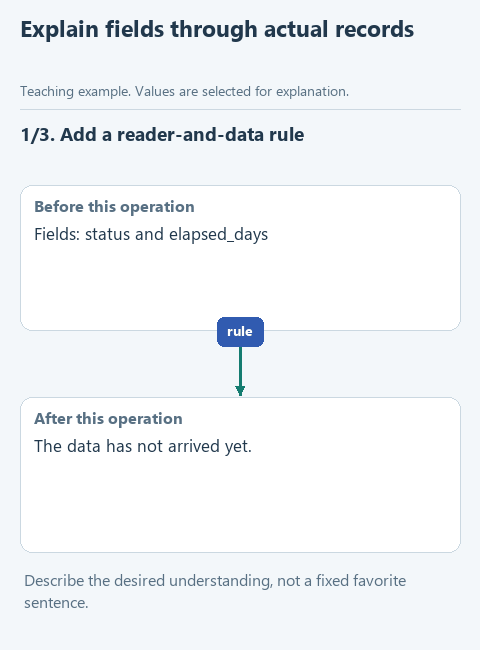

# Explain the data before the selection rule

The instruction to write clearly can be interpreted in many ways. We will make it observable: a first-time reader should understand the table fields and be able to explain why A-17 is selected.

## Open this experiment

Download [writing-03-reader-context](../downloads/writing-03-reader-context.zip), extract it into its own folder and open that folder in OpenCode. Use a plain text editor for the lesson files. Earlier parts are prepared; the current change is yours to make. Keep previous outputs in their original folders so comparisons remain possible.

## Perform the experiment

The previous basic rule is prepared in this starter. Open `SKILL.md` under `.opencode/skills/write-clear-english` and add a short paragraph in the marked place.

For its first part, require the explanation to establish the reader's task before naming fields. For the second, require the meaning of `status` and `elapsed_days` to be shown on the current records, preserving both selection conditions. For the third, require a transition before a threshold or data set changes, including what changes and why.

Describe the desired understanding, rather than forcing one favorite sentence into every answer. The requirement should still work if a future input uses different row IDs or a different task. Do not add an unsupported claim about efficiency.

Save, create a new session, select the same model and send `PROMPT.md`. Do not paste your new rule into the current request; we are checking whether it arrives from the changed skill. Confirm loading, then save the answer as a new result.

Read it against the facts. Can you explain the values and both conditions? Is the five-day threshold introduced as a separate experiment? If the editor simply removed the second experiment, check that the prompt asked to retain it before diagnosing a style failure.

[Static alternative](../assets/step-03.png). These are illustrative values and steps, not a recorded model run.

## What to record

The input and model are unchanged. The reader can reconstruct selection from the actual records, and the threshold does not change silently. Record remaining gaps rather than treating a smooth paragraph as proof of correctness.

Use `results/observations.md` to separate the changed instruction, observed loading and actual output. Do not claim a model comparison from file validation alone.

[All lessons](../README.md#lessons).
