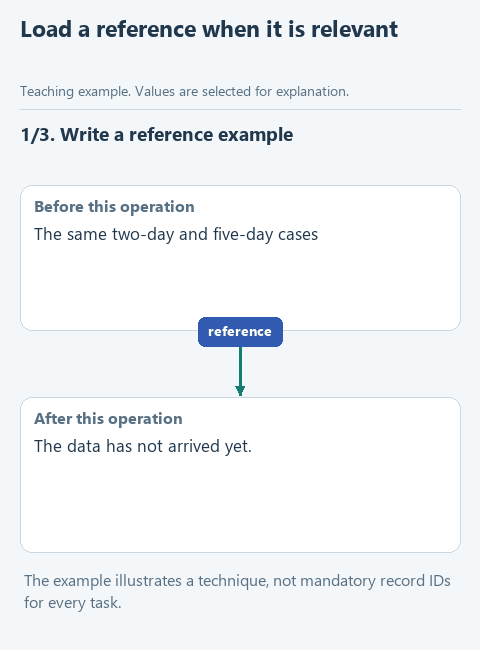

# Move a useful example into a reference

> **Where we are.** SKILL.md holds two rules. Now we move an example into a separate reference file and check that the agent reads it.

As examples and detailed explanations pile up, the main instruction becomes hard to navigate. It is easier to keep them in a reference file and leave in `SKILL.md` a note saying when to read it. Today we move the threshold-change example and check whether the agent actually received it while doing the task.

## Open this step

Download [writing-04-references](../downloads/writing-04-references.zip), extract it into its own folder and open that folder in OpenCode with the same model.

## Do the experiment

Open **.opencode -> skills -> write-clear-english -> references -> reader-first.md**. It has a heading already; complete the marked example. First explain the selection of requests older than two days, then announce a second experiment that checks the same two rows with a five-day threshold, and state its outcome. Keep the rows as they are, so the result depends only on the new condition, and add no measured benefits.

Now open `SKILL.md` and, at the marked place, add a note to read the reference before explaining unfamiliar fields or changing the example. Write it as a Markdown link: a title in square brackets, such as `Threshold example`, followed straight away by the address `references/reader-first.md` in round brackets. The address is relative to the skill folder. The link names the resource; the surrounding sentence says when it is needed.

Create a new session and send the unchanged `PROMPT.md`. In the trace, look for two separate events: loading the main instruction and reading `references/reader-first.md`. A file sitting next to `SKILL.md` is not automatically part of what the model sees, as the [OpenCode documentation](https://opencode.ai/docs/skills/) explains.

If the reference is not read, check the path and the condition in `SKILL.md`. A phrase like "follow best practices" names neither a resource nor a moment to use it. After fixing it, start a new session.

Then compare the edit with the criteria from the last lesson. Moving the example into a file does not improve the text by itself; what we want to see here is that the reference was read and its rule still takes part in the work.

[Static version](../assets/step-04.png).

## Before the next step

The link in `SKILL.md` leads to an existing file, and the trace shows it being read. The edit keeps both selection conditions, and the threshold change, if it is there, does not appear out of nowhere.

Next: [separate a mechanical check from an editorial judgment](05-checks.md). [All lessons](../README.md#lessons).
