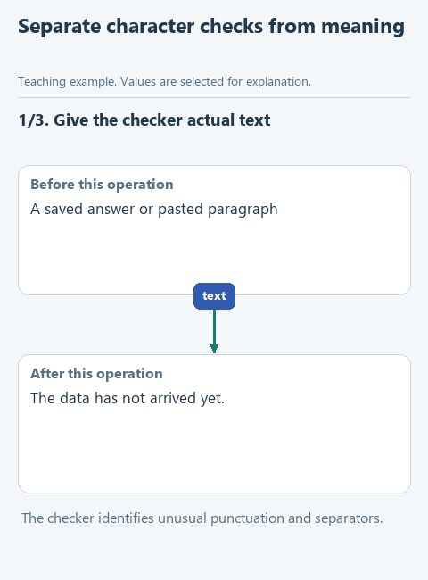

# Separate a mechanical check from an editorial judgment

> **Where we are.** The skill has an instruction and a reference. Now we add a program that checks formatting, and look at what it cannot check.

Some rules a program checks more reliably than an eye: ordinary straight quotes and typographic quotes, for example, differ in their character codes. Such a check is useful as long as we do not ask it a question it cannot answer. This step has a small script and a browser page ready; no JavaScript to write.

## Open this step

Download [writing-05-checks](../downloads/writing-05-checks.zip), extract it into its own folder and open that folder in OpenCode with the same model.

## Do the experiment

In File Explorer, double-click `check-text.html` in the project folder; it opens in the browser. Paste your latest edited answer into the text area and click **Check**. If you have no answer yet, first run the edit through OpenCode with the same `PROMPT.md`.

For a quick control experiment, paste a sentence with straight quotes, then the same sentence with curly quotes from any of your old documents. In the first case we expect nothing to be reported; in the second, lines with character codes such as `U+201C`. The program compares character codes and nothing else.

In the skill folder, find `scripts/check_text.js`: the page you opened uses exactly this script. With Node.js installed, an agent could run it from a terminal, for example `node .opencode/skills/write-clear-english/scripts/check_text.js results/article.md`, but for our experiment the browser is enough. That is how a program for one specific check ends up inside a skill, next to the rules written in words.

Now complete the marked paragraph in `SKILL.md`: use ordinary keyboard punctuation, name the checker, and say plainly that it reports characters, does not judge meaning and does not change files. Run the same editing request in a new session. If you checked the text in the browser yourself, paste the report into the chat; the agent should not claim it ran the program on your behalf.

Finally, paste the sentence `Request A-18 is ten days overdue.` into the checker. There is no unusual punctuation in it, so it passes, even though it contradicts our facts. After the program, you still read the meaning yourself.

[Static version](../assets/step-05.png).

## Before the next step

The program reports unusual characters and leaves the file untouched. You also found a factual error it could not see, which shows which part of the work the script does and which part stays with you.

Next: [try the skill on a different explanation](06-transfer.md). [All lessons](../README.md#lessons).
