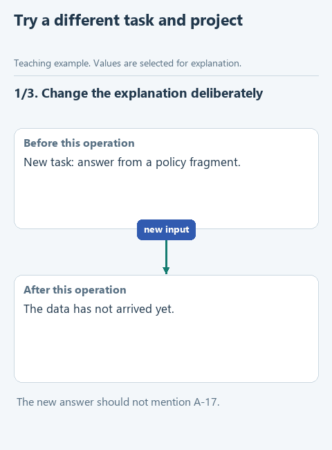

# Try the skill on a different explanation

> **Where we are.** The skill is assembled. Now we try it on another text and in a new project.

So far we improved the same text about approval requests. Now we try the skill on an explanation of a different kind and move it into a separate project folder. We want to see whether the instruction helps with a new task, and whether the agent drags the approval requests from the old exercise into the new answer.

## Open this step

Download [writing-06-transfer](../downloads/writing-06-transfer.zip), extract it into its own folder and open that folder in OpenCode with the same model.

## Do the experiment

This starter has `transfer-source.md` and `transfer-facts.md`: now the reader wants to understand an assistant's answer based on a fragment of a policy document. Read both files first. The names, conditions and data are new, but the skill's job is the same: give the reader a clear explanation without invented facts.

Create a new session, open `TRANSFER-PROMPT.md` and send its text. Check whether the explanation says which document fragment the assistant received, acknowledges that a skill does not grant access to files, and keeps "asked to report missing information" apart from "guaranteed to do so". Check also that A-17 and A-18 from the earlier example do not appear.

If the answer about the policy mentions the approval requests again, check `SKILL.md` and the reference: does the instruction tell the model to repeat the earlier example? It should ask for concrete current data, not for that particular example. Change only that rule, repeat the request in a new session with the same model and keep both answers.

To move the skill, copy **only the write-clear-english folder, whole**, from `.opencode/skills` into the same place in a new project. Check that `references`, `scripts` and `assets` came along if the instruction links to them. Do not copy `results`, `facts.md` or the chat history: they are not part of the skill.

Create a new folder `writing-transfer-check` next to the lesson folder. Inside it create `.opencode`, inside that `skills`, and copy `write-clear-english` there. Copy `transfer-source.md`, `transfer-facts.md` and `TRANSFER-PROMPT.md` to the root of the new folder and create an empty `results` folder. Open `writing-transfer-check` in OpenCode, choose the same model, send `TRANSFER-PROMPT.md`, check the loading in the trace and save the answer as `results/transfer-answer.md`. Do not install the skill globally as a shortcut: this experiment is about moving the local folder.

In `results/observations.md`, describe the path of the instruction in your own words: how the agent finds the skill, when it reads the reference and who runs the checker. Note separately what you had to judge by meaning yourself.

[Static version](../assets/step-06.png).

## When the workbook is done

The agent loads the skill from the new project and explains the current data without approval requests from the old example. References and scripts stay inside the portable folder, while results and working documents stay outside it.

The workbook is complete. Compare your version with the [ready-made skill](../skill/write-clear-english/SKILL.md) and save your observations. [All lessons](../README.md#lessons).
